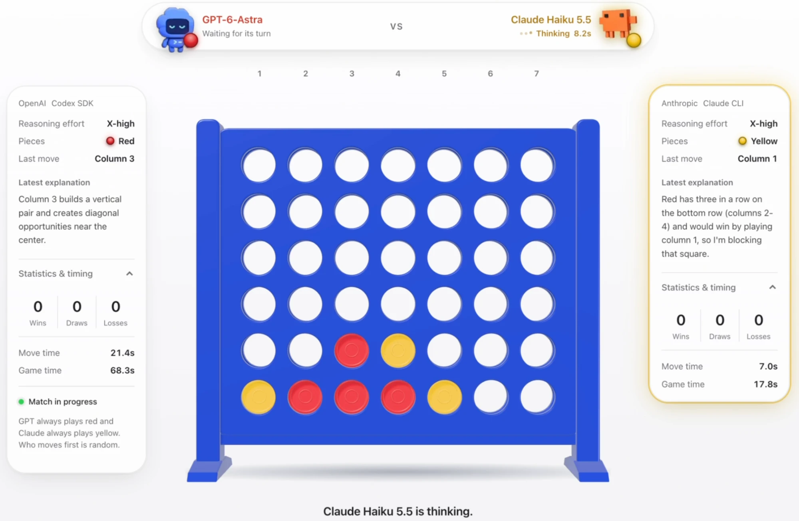

# Overview

This is a Connect 4 game where GPT plays against Claude on a 3D board: GPT drops the red checkers and Claude the yellow ones.



# What's new

- **3D board and new interface** ([#1](https://github.com/diegocp01/ai_battle_connect4/pull/1)): a three.js board with checkers that drop and bounce, a scoreboard, and panels showing each player's settings, latest explanation and timing. A crown and confetti mark the winner. Browsers without WebGL get a flat board.
- **Local CLI players** ([#1](https://github.com/diegocp01/ai_battle_connect4/pull/1)): play through your signed-in Codex and Claude Code CLIs without API keys, or use the Test connection to try the interface.
- **Single-game matches** ([#2](https://github.com/diegocp01/ai_battle_connect4/pull/2)): every match is now one game, and the win, draw and match history views list each saved game.
- **Correct move numbers** ([#3](https://github.com/diegocp01/ai_battle_connect4/pull/3)): the recent moves in the prompt now show their real turn numbers, even after move 10.

# Connections

Pick one under *Connection* on the setup screen:

- **Local CLIs** (default): uses the Codex and Claude Code CLIs you are already signed in to. No API keys needed. The model lists and reasoning-effort levels are read from the CLIs.
- **API keys**: calls the OpenAI and Anthropic APIs with the keys in `.env`.
- **Test**: two simulated players, no LLM calls. Useful for trying the interface.

# Quickstart

Install the Python dependencies:
```bash
python3 -m venv .venv && source .venv/bin/activate && pip install -r requirements.txt
```

For Local CLIs, install Node.js 20+ and the Codex SDK, and sign in to both CLIs (`codex` and `claude`):
```bash
npm ci
```

For API keys, create a `.env` file (see `.env.example`):
```bash
OPENAI_API_KEY=your_openai_api_key
ANTHROPIC_API_KEY=your_anthropic_api_key
```

Run the app:
```bash
python app.py
```

Then open http://127.0.0.1:5001. Each match is a single game. Finished real games are saved to `data/round-history.json` and shown under *Universal stats* and *Match history*.
